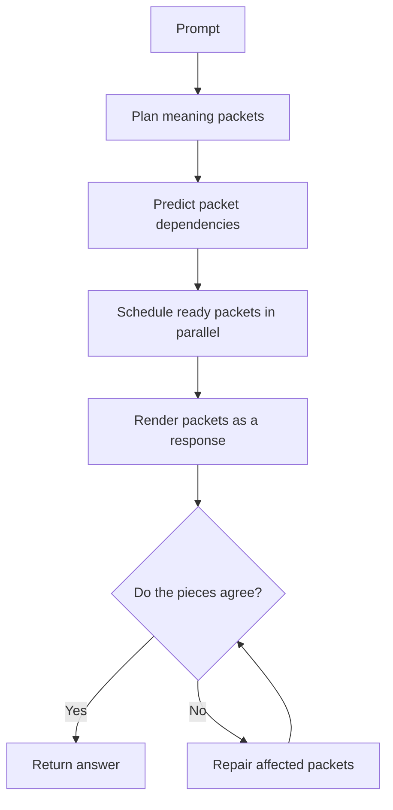
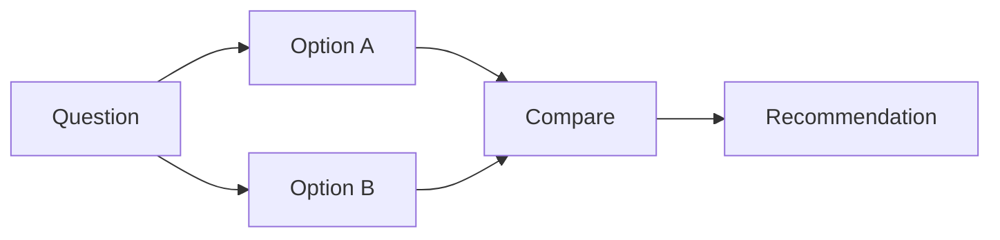

# Causal Packet Networks (CPN)

**A research proposal for generating independent parts of an answer in parallel.**

> **Status:** idea and research plan. There is no CPN model or measured CPN result yet. The 5× goal below is a target to test, not a performance claim.

## The idea, in plain English

Most chat models write one token, then use it to decide the next token, and keep doing that until the answer is done. That works well, but makes the whole answer wait on a long chain of small decisions.

I want to test a different way: have the model split an answer into **meaning packets**—small pieces such as a claim, a reason, an example, or one step in an instruction. It draws which packets need other packets first. Then it can work on independent packets at the same time, put them back into a readable answer, and check that the pieces agree.

The point is not to make a second model write the answer and a big model check it. The goal is for one trained system to plan, generate, and check packets while doing less total work.

**Main question:** can this make answers faster and cheaper to generate *and* improve coherence on tasks where parts of the answer depend on one another?

## How it is meant to work

### 1. Plan the answer

The planner decides what pieces the response needs. For “compare two options and recommend one,” it might create packets for the first option, the second option, the comparison, and the recommendation.

Packets should have **variable lengths**. A short fact might need a small packet; a complicated reason could need a larger one. Fixed-size blocks are a baseline to compare against, not an assumption that should be built into the final design.

### 2. Draw the dependencies

An arrow means one packet needs information from another. Independent packets can be prepared together.

For example:

Option A and Option B can be worked on in parallel. The comparison must wait for both, and the recommendation must wait for the comparison. This graph is a **dependency plan**; it does not mean the answer is automatically correct.

### 3. Run the ready work together

A scheduler finds packets whose prerequisites are complete and sends them through a shared model in a batch. After that batch finishes, it schedules the next ready packets. The model still has to do the work inside each packet; the hoped-for gain comes from doing independent packets together and avoiding unnecessary serial steps.

### 4. Render and check the answer

A renderer turns packet contents into fluent text and places them in a sensible order. A checker looks for conflicts, missing steps, or a packet that relies on information it does not have. If the check fails, the system should repair the affected packet and any packets that depend on it, instead of rewriting everything.

The checker and repair loop might cost more than it saves. The experiment has to count those costs.

## Why this might be faster

Let **W** be the total amount of model work, and **S** the work on the longest dependency chain. With unlimited parallel hardware, execution still cannot be faster than the longest chain; with a real device, it also cannot beat the work divided across the available processing capacity. Planning, scheduling, rendering, and repair add more time.

A rough lower bound is:

[
T_{mathrm{parallel}} geq max(W/P,;S) +
T_{mathrm{plan}}+T_{mathrm{render}}+T_{mathrm{check}},
]

where **P** is the usable parallel capacity. This is a way to reason about limits, not a speed prediction. If most packets depend on earlier packets, the graph gives little parallelism. If packets are too small, scheduling costs may eat the gain. If they are too large, generation becomes harder and the parallel batches may be inefficient.

**Tokens per second, latency, and compute are different measurements.** A method can produce more tokens per second while using more total compute. We need to measure each one.

## What is already known, and what may be new

Research has already explored several close ideas:

| Prior work | What it does | Why it matters for CPN |
|---|---|---|
| [PASTA, in Self-Orchestrating Language Models](https://arxiv.org/abs/2609.14850) | Trains a model to mark output chunks that can be generated independently, then uses those annotations to parallelize autoregressive decoding. | This overlaps directly with CPN’s central idea of generating independent semantic chunks in parallel. |
| [DA-DLM](https://arxiv.org/abs/2609.15070) | Uses a position-oriented dependency DAG to coordinate token predictions during diffusion decoding. | DAG-based token dependencies in parallel generation already have a direct precedent. |
| [DAPD](https://proceedings.mlr.press/v306/kim26t.html) | Builds a dependency graph from attention and selects independent tokens to unmask in parallel in diffusion language models. | Dependency-aware scheduling is not new on its own. |
| [Multi-token prediction](https://proceedings.mlr.press/v235/gloeckle24a.html) | Trains shared model layers to predict several future tokens; the authors report up to 3× faster inference in their tested setup. | This is a required speed baseline, and shows that faster decoding can sometimes also improve quality. |
| [CoDiLA](https://proceedings.mlr.press/v306/hersche26a.html) | Combines parallel diffusion generation with a small autoregressive model for local coherence. | Local sequential decoding inside parallel generation is also established prior work. |

### Honest novelty status

The broad CPN pitch—“make semantic chunks, model their dependencies, and generate independent chunks in parallel”—**is not new enough to claim as an original invention** based on this research. PASTA is especially close.

A possible research contribution would need to be narrower and demonstrated against that work. One candidate to investigate is **learned variable-size packet boundaries optimized jointly for end-to-end cost, with bounded local repair that preserves whole-answer constraints**. This is only a candidate distinction. We have not verified that it is novel, and it may already be covered by other work.

Before presenting CPN as a new method or a new kind of AI, the related-work review must compare its exact training objective, dependency representation, scheduler, and repair procedure with the papers above. If the difference is not substantial, the right move is to re-scope the project or treat it as a reproduction and extension study.

## How someone could build a first version

This is a research project. It does **not** require inventing a programming language or writing a neural-network engine from scratch.

### Recommended stack

- **Python** for experiments, data processing, training scripts, and evaluation.
- **PyTorch** for the model, losses, batching, and training. PyTorch is code; it provides the tensor and automatic-differentiation engine so the research does not have to implement matrix math from zero.
- **Hugging Face Transformers and Datasets** for a baseline model, tokenizers, and dataset loading.
- **NetworkX** or a small custom DAG scheduler for offline graph analysis and the first prototype. Do not put a heavyweight graph library in the fast inference path without profiling it.
- **Triton, CUDA, or C++ only later**, if benchmarks show Python scheduling or tensor kernels are the actual bottleneck. Writing custom GPU code too early makes the project harder without proving the idea.
- **Git + pinned package versions + fixed seeds** so other people can reproduce the runs.

The starting model can be a small decoder-only Transformer. Keep the baseline and CPN as close as possible in backbone size, tokenizer, training data, precision, and device. A first experiment should be small enough to run on one available GPU; a phone or CPU can run graph and code checks, but will not make a large language-model experiment practical.

### Build in stages

1. **Prove the graph idea on paper.** Create a small set of multi-part answers, mark packets and dependencies, and measure the longest dependency chain. If almost every packet is sequential, stop or narrow the tasks.
2. **Make an oracle upper bound.** Give a scheduler hand-written correct graphs. This tests the runtime only; it is not a real-model result and must never be presented as the method’s achieved speed.
3. **Build the serial baseline.** Run the same small model normally and record output quality, latency, compute, and memory.
4. **Add the simplest packet prototype.** Start with sentence or clause packets and a basic dependency representation. Variable learned packetization can come after the pipeline works.
5. **Add learned planning.** Train the model to produce packet boundaries and dependency links. Compare against hand-labeled or weakly labeled examples, and measure graph mistakes.
6. **Add scheduling and repair.** Run independent packets together; measure whether checking and repair actually help and what they cost.
7. **Test the graph runtime.** Run `python -m unittest discover -s tests -v`. The included scheduler tests only verify DAG scheduling and critical-path calculations; they do not test an AI model or prove a speedup.\n8. **Optimize only after profiling.** Try PyTorch compilation or custom kernels only after measuring a real bottleneck.

## What to compare

A fair evaluation needs more than “CPN versus ordinary decoding.” Compare:

- a standard autoregressive decoder;
- multi-token prediction or speculative decoding;
- fixed-size block-parallel generation;
- CPN with a learned graph;
- CPN with an oracle graph, reported only as an upper bound.

Use the same prompts, output length policy, precision, hardware, and sampling settings. Test both one-user generation and a separate batched setting. Report:

- **Latency:** time to first token and full answer, plus median and p95.
- **Speed:** generated tokens per second.
- **Compute:** FLOPs if measurable, or a clearly explained proxy; count every planner and repair call.
- **Memory:** peak device memory and context/cache use.
- **Quality:** task score, correctness, completeness, coherence, and contradictions.
- **Graph behavior:** packet count, average packet size, dependency density, parallel width, critical-path length, graph errors, and repair rate.
- **Tradeoffs:** quality at matched compute and compute at matched quality.

Use repeated runs and report uncertainty. Do not cherry-pick the one task or prompt where it wins.

## The 5× goal

The project’s stretch goal is **5× higher generation speed while using less compute and producing better answers**. These are three separate outcomes. A result only counts if end-to-end timing includes graph planning, scheduling, rendering, checking, retries, and repair. Quality improvement needs a predefined metric or a blinded human preference study.

It is completely possible that CPN misses the target or loses to existing methods. A careful negative result is more useful than a speed claim based only on theoretical parallelism.

## Repo contents

- [PROPOSAL.md](PROPOSAL.md) — formal problem statement, hypotheses, objective, and limitations.
- [EXPERIMENT_PLAN.md](EXPERIMENT_PLAN.md) — staged evaluation and reporting rules.\n- [research/scheduler.py](research/scheduler.py) — pure-Python reference list scheduler and work/span metrics.\n- [tests/test_scheduler.py](tests/test_scheduler.py) — dependency and scheduling sanity tests.

## Sources and implementation references

- [Self-Orchestrating Language Models / PASTA](https://arxiv.org/abs/2609.14850)
- [DA-DLM](https://arxiv.org/abs/2609.15070)
- [DAPD, ICML 2026](https://proceedings.mlr.press/v306/kim26t.html)
- [Multi-token prediction, ICML 2024](https://proceedings.mlr.press/v235/gloeckle24a.html)
- [CoDiLA, ICML 2026](https://proceedings.mlr.press/v306/hersche26a.html)
- [PyTorch documentation](https://docs.pytorch.org/docs/stable/)
- [PyTorch torch.compile](https://docs.pytorch.org/docs/stable/generated/torch.compile)
- [Hugging Face causal language modeling guide](https://huggingface.co/docs/transformers/en/tasks/language_modeling)

## Current status

This README describes a research proposal and a path for testing it. A small pure-Python DAG scheduler now exists and its six unit tests pass locally. It is only a graph-level sanity check: no CPN model has been implemented or benchmarked, and the overlap with PASTA and other dependency-aware parallel-decoding work remains a major open issue for any novelty claim.
